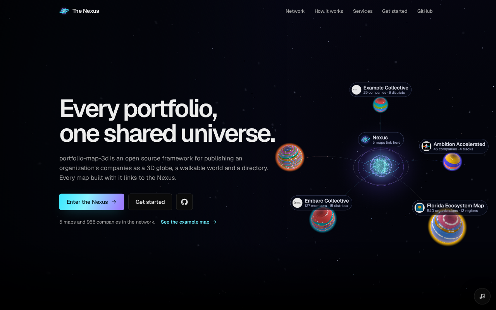
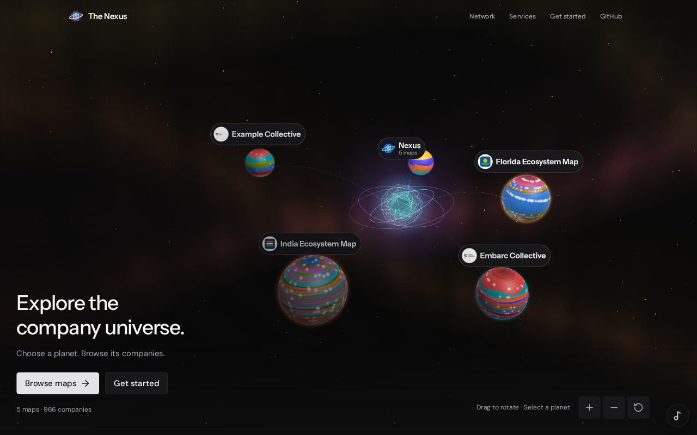
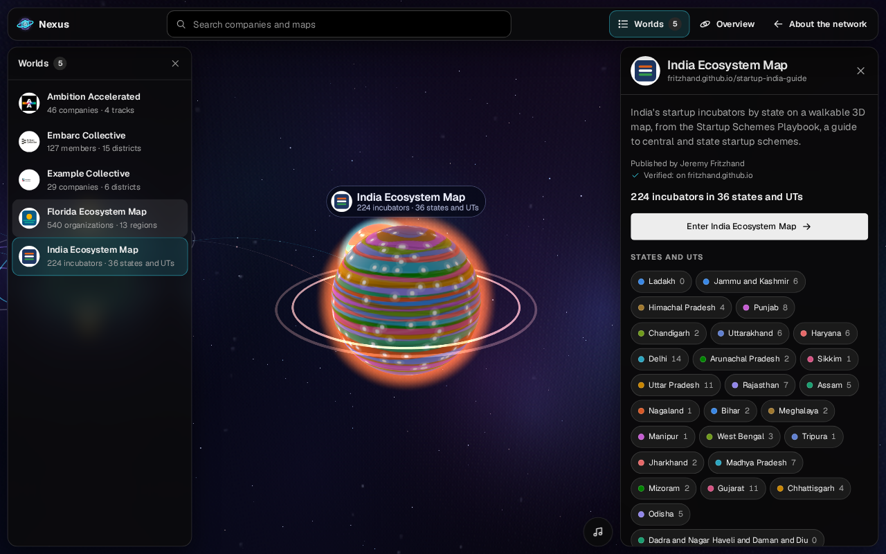
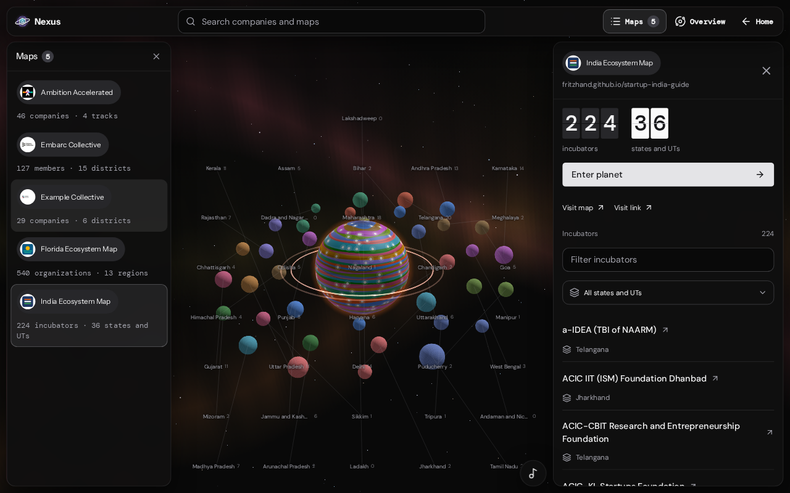
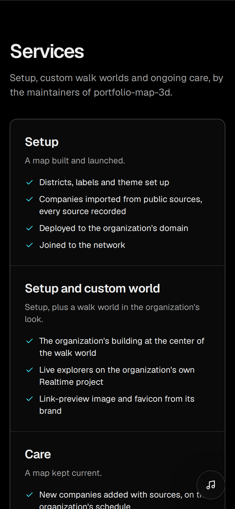
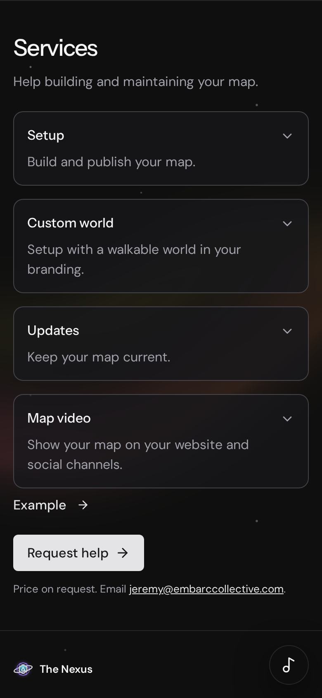

# Nexus universe redesign

The captures compare `88d87b2` on `origin/main` with this branch. Desktop pages use a
1440 × 900 CSS viewport; mobile services use 390 × 844. The saved screenshots preserve
the browser's screenshot output size and device scaling.

| View | Before | After |
| --- | --- | --- |
| Landing |  |  |
| Selected planet |  |  |
| Mobile services |  |  |

## Rendering comparison

Both measurements use the same five-map, 966-company snapshot, a 1440 × 900 host,
reduced motion, and a fresh `NexusEngine`. Each view advances once and then renders.
The projection check advances the settled India view 60 times without changing inputs.
These measure geometry and repeated work, rather than frame rate.

| Work | Main `88d87b2` | This branch |
| --- | ---: | ---: |
| Overview triangles | 41,602 | 15,554 |
| Overview draw calls | 23 | 23 |
| India focus triangles | 40,250 | 16,128 |
| India focus draw calls | 19 | 7 |
| Projection rebuilds over 60 unchanged updates | 60 | 0 |

The candidate uses an 8-million backing-pixel budget with DPR capped at 2.5,
instanced moons, cached label layouts, and a loop that stops when focus settles.
The overview includes the warm aurora shader.
